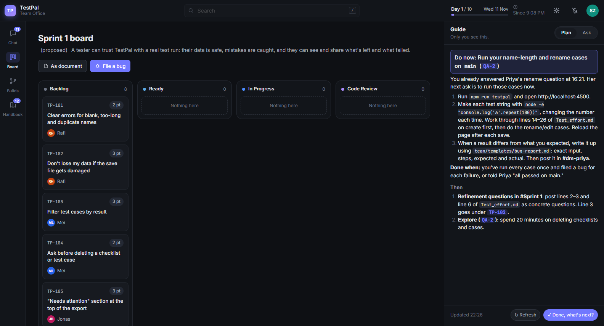
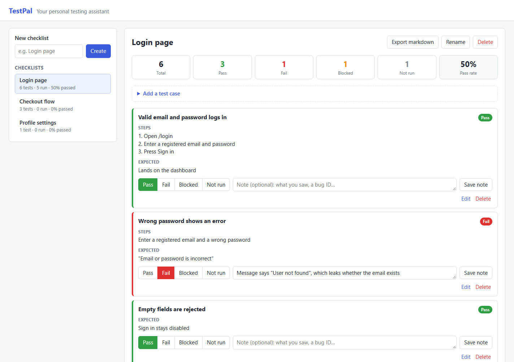
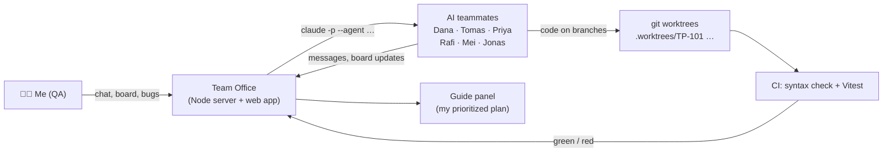

<div align="center">

# QA Team Simulator

**Practice real-world QA on a software team made of AI teammates.**

I'm the QA engineer. Six AI colleagues (a product manager, a project manager, a QA lead and three developers) plan
sprints, write code, push back on my bug reports and ship. They're building **TestPal**, a personal testing
assistant, and my job is to find out what's broken before it ships.


</div>



---

## Why I built this

Testing tutorials teach techniques. They don't teach what's hard about QA on a real team: refining vague acceptance
criteria, a developer replying "can't reproduce" or "works as designed", a project manager asking you to skip
regression to hit a date, or a product manager who wants to ship with a known bug. This project recreates that,
with enough realism to practice the judgment calls, and stays light on paperwork so the time goes into testing.

## Highlights

| | |
|---|---|
| **A team with personalities** | Each teammate is a Claude Code agent with a role, a voice and opinions. The senior backend dev bounces vague bug reports. The junior dev reads acceptance criteria literally. The PM pushes to ship. |
| **A working office** | A local web app with team chat, DMs, a sprint board, a bug tracker, CI builds and a handbook. It's all live: teammates' messages, board moves and build results stream in. |
| **A workday that runs itself** | No clock-in. The day starts when I start working and ends when I go idle. Then the team holds its meetings, writes code on its own git branches, reviews and fixes, and the results are waiting next morning. |
| **Real code, real CI** | Developers work in git worktrees on real branches. A small CI pipeline checks and tests every branch on each commit. QA tests only green builds. |
| **Seeded defects** | Developers may slip in one realistic bug per ticket (an untested error path, an off-by-one, a misread criterion), logged in a hidden answer key. At the retro, the QA lead reveals which ones I caught. |
| **Surprises** | Some mornings bring the unplanned: a user-reported bug, a mid-sprint scope change, someone out sick, a dev asking for "just a quick look" without process. |
| **A private Guide** | A mentor docked beside the office keeps a prioritized plan of what to do next and how to test it, and it updates as the team works. It never reveals the seeded defects. |

## The product under test: TestPal

A small local web app where people keep test cases in checklists, run them, record Pass, Fail or Blocked with notes,
and export a markdown summary to paste into a ticket. The team built v0 before Sprint 1. Each sprint adds features
(and bugs).



Plain JavaScript with zero runtime dependencies: a Node `http` server with a JSON API, file storage, and a
framework-free front end. 50+ unit tests with Vitest.

## How it works



- **The office** (`team/chat/`) is a dependency-free Node server: REST endpoints, server-sent events for live updates,
  JSONL chat history and a presence heartbeat that starts and ends the workday.
- **Teammates** are Claude Code subagents (`.claude/agents/`). Each one reads its journal, the board and the team
  rules before acting, so it remembers promises across days.
- **Meetings** (planning, refinement, standup, triage, review, retro) run without me in a hidden room. The QA lead
  relays only what I wrote, so my written input has to stand on its own. Outcomes are posted to the channels.
- **The board and bug tracker** are markdown files (`team/board.md`, `team/bugs/`) that the office parses and edits.
  They're readable by humans and by agents.

## A sprint in the simulator

| Day | What happens |
|---|---|
| 1 | Explore TestPal v0. Post questions for refinement. The team plans the sprint. |
| 2–3 | First tickets reach *Ready for QA*. I test on green builds, file bugs and set severity. |
| 3, 6, 8 | Bug triage: devs respond to my bugs (accept, dispute, "can't reproduce") and the PM sets priority. |
| 4, 9 | Short check-ins from my QA lead. |
| 10 | Regression run on `main`, my go/no-go, the ship decision, and the retro with the seeded-defect reveal. |

## QA skills I practice here

- Exploratory testing in time-boxed sessions
- Boundary value analysis and equivalence partitioning
- Error-path and data-integrity testing (reloads, restarts, corrupt files)
- API testing with `curl`, alongside UI testing
- Bug reports that survive developer pushback: exact steps, expected vs. actual, evidence, severity with a reason
- Severity vs. priority, and defending a call with evidence
- Holding the Definition of Done under schedule pressure
- Regression checklists and a risk-based go/no-go recommendation

## Getting started

Prerequisites: **Node.js 20+** and the **[Claude Code](https://claude.com/claude-code) CLI**, signed in (the
teammates run through it).

```bash
npm install

npm run team-chat     # the Team Office → http://localhost:4321
npm run testpal       # the product      → http://localhost:4500
npm test --prefix testpal
```

| Setting | Effect |
|---|---|
| `TEAM_CHAT_MODEL=sonnet` | Cheaper teammate runs (an end of day is about a dozen) |
| `TEAM_IDLE_MINUTES=45` | How long idle counts as "stopped for the day" (default 30) |
| `team/.training/settings.md` | Difficulty: seeded defects, dev pushback (`gentle` / `realistic` / `tough`), surprises, coaching |

## Project structure

```
testpal/                The product under test (server, API, storage, web page, tests)
team/
  chat/                 The Team Office web app (server, agents runner, CI, Guide)
  README.md             The in-world handbook: start here once you're in the office
  PRODUCT.md            What TestPal does, its API, who owns which file
  board.md, tickets/    Sprint board and tickets
  bugs/, qa/            Bug reports and my QA space
.claude/agents/         The AI teammates and the Guide
.claude/skills/         The meetings (/standup, /refinement, /triage, /demo, /retro…)
src/                    Intent Tests (see below)
```

<details>
<summary><b>Behind the scenes</b> (kept out of the office UI on purpose)</summary>

| What | Where |
|---|---|
| Difficulty settings | `team/.training/settings.md` |
| How the AI teammates are told to behave | `.claude/agents/`, `team/TEAMMATE-RULES.md` |
| Teammates' private journals (their memory) | `team/people/` |
| The seeded-defect answer key (local only, never committed) | `team/.seeded/` |
| Meeting transcripts | `team/chat/history/meetings.jsonl` |
| The Guide's instructions, conversation and plan | `.claude/agents/guide.md`, `team/chat/history/guide*.json*` |

From Claude Code you can also talk to teammates by name, or run `/standup`, `/triage` and the other meetings.

</details>

## Also in this repo: Intent Tests

`src/` holds **Intent Tests**, a VS Code extension, CLI and MCP server that finds the behaviors in JS/TS functions
and checks them against what the code says it intends (`npm run compile`, then `node out/cli.js --help`). It was
the team's first product. It's paused while the team builds TestPal, and may come back as a later "project".

---

<div align="center">

Built by **[Samin Zaman](https://github.com/Samin-Zaman1)**, QA engineer.

</div>
